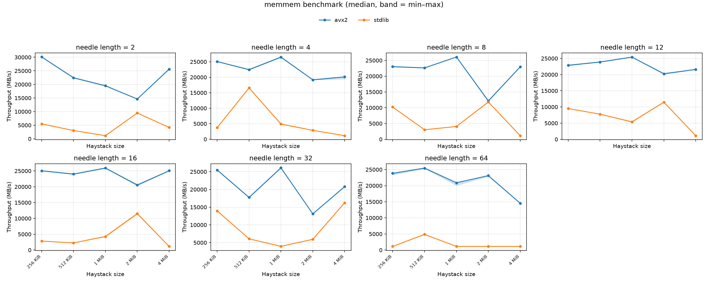

# Memmem
SIMD accelerated search routines for Go

This is a rough port of Rust's [memmem](https://github.com/BurntSushi/memchr/tree/master/src/memmem).
It is typical 4-6 times as fast as `bytes.Index` on the benchmark
data below, depending on the size of the search space. See [benchmarks](#benchmarks) for details.

## Algorithm

The search is the "generic SIMD" algorithm from Wojciech Muła's
[SIMD-friendly algorithms for substring searching](http://0x80.pl/notesen/2016-11-28-simd-strfind.html).
The first and last byte of the needle are broadcast into two vectors. Each
step compares them against two loads of the haystack that are `len(needle)-1`
bytes apart and combines the results into a bit mask of candidate positions.
Only at those positions are the remaining needle bytes compared.

## Platform support

| Platform | Implementation |
|---|---|
| amd64 with AVX2 | [`simd/archsimd`](https://pkg.go.dev/simd/archsimd), 32 bytes per vector |
| anything else | `bytes.Index` |

## Build Instructions

The SIMD code uses Go's [`simd/archsimd`](https://pkg.go.dev/simd/archsimd)
package. It needs Go 1.27 or newer and is only compiled in with the
experiment enabled:

```
$ GOEXPERIMENT=simd go test ./...
```

Without `GOEXPERIMENT=simd`, or on a CPU without AVX2, `Index` falls back to
`bytes.Index`.

## Benchmarks

The benchmark `BenchmarkIndexNeedleLen` runs on synthetic logging data in two dimensions. One is a needle length from
two to sixtyfour. The other is the haystack size which is 256 KiB to 4 MiB.



The plot shows throughput over haystack size for different needle sizes. The algorithm has the bigger advantage on
longer needles over larger haystacks. 

<details>
<summary>benchstat: index benchmark, <code>avx2</code> against <code>stdlib</code></summary>

```
> GOEXPERIMENT=simd go test -run='^$' -bench='BenchmarkIndexNeedleLen' -count 10 ./... > results.log
> benchstat -row "/haystackSize" -col "/impl" results.log
goos: linux
goarch: amd64
pkg: github.com/jeschkies/go-memmem/pkg/search
cpu: AMD Ryzen 9 9950X 16-Core Processor
        │      avx2      │                  stdlib                   │
        │     sec/op     │     sec/op       vs base                  │
262144    10.48µ ±  5% ¹    47.69µ ± 48% ¹   +355.25% (p=0.000 n=70)
524288    23.15µ ±  5% ¹   107.65µ ± 60% ¹   +365.02% (p=0.000 n=70)
1048576   40.46µ ±  2% ¹   258.01µ ±  4% ¹   +537.63% (p=0.000 n=70)
2097152   109.4µ ± 31% ¹    221.0µ ± 60% ¹   +101.99% (p=0.000 n=70)
4194304   194.1µ ±  6% ¹   3679.2µ ±  0% ¹  +1795.45% (p=0.000 n=70)
geomean   46.11µ            254.9µ           +452.92%
¹ benchmarks vary in .fullname

        │       avx2       │             stdlib              │
        │       B/s        │       B/s        vs base        │
262144    23.305Gi ±  4% ¹   5.119Gi ± 73% ¹  -78.03% (n=70)
524288    21.093Gi ±  5% ¹   4.536Gi ± 38% ¹  -78.50% (n=70)
1048576   24.136Gi ±  2% ¹   3.785Gi ±  5% ¹  -84.32% (n=70)
2097152   17.853Gi ± 24% ¹   8.839Gi ± 37% ¹  -50.49% (n=70)
4194304   20.125Gi ±  6% ¹   1.062Gi ±  0% ¹  -94.72% (n=70)
geomean    21.18Gi           3.831Gi          -81.91%
¹ benchmarks vary in .fullname
```

</details>
